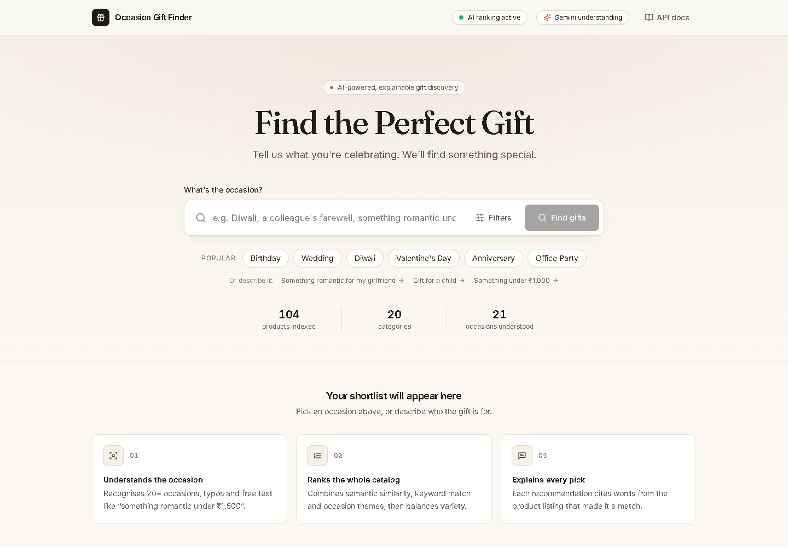
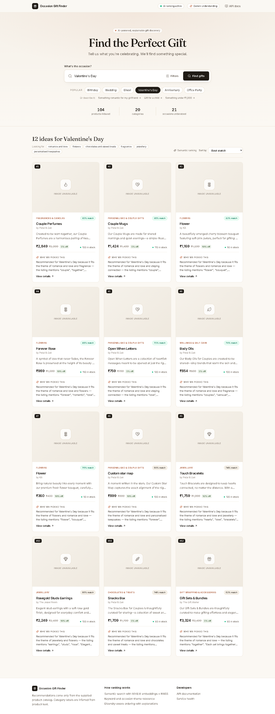

# Occasion-Based Product Recommendation System

Type an occasion — *"Diwali"*, *"Valentine's Day"*, or free text such as *"something romantic for my girlfriend under ₹1,500"* — and get a ranked, explained shortlist of products from the supplied catalog, rendered directly below the search box.

The engine is a **hybrid recommender**: MiniLM sentence embeddings searched with **FAISS**, combined with IDF-weighted keyword relevance and a curated **occasion → concept** layer. It runs fully locally, with no paid API keys, and falls back to TF-IDF automatically if the embedding model is unavailable.

An **optional Gemini LLM layer** can interpret complex natural-language requests (*"something for my mom's bday, nothing above 1500 rupees"*) into a structured query of occasion, recipient, budget, themes and preferences. That query then feeds the same retrieval and ranking engine. The LLM never sees or produces product data, and the app works identically without an API key ([details](#optional-llm-query-understanding-gemini), [evaluation](docs/llm_evaluation.md)).

| Occasion input | Results (Valentine's Day) |
|---|---|
|  |  |

More screenshots: [Diwali](screenshots/03-results-diwali.png) · [free text + budget](screenshots/04-free-text-budget.png) · [empty state](screenshots/05-empty-state.png) · [mobile (390 px)](screenshots/06-mobile.png) · [Graduation](screenshots/07-results-graduation.png) · [product detail](screenshots/08-product-detail.png) · [natural-language query understood by Gemini](screenshots/09-natural-language-llm.png). They are regenerated from the running app with `node e2e/capture-screenshots.mjs` (in `frontend/`).

> **Note on product images.** Every card uses the product's real `mainImage` URL, unchanged. At the time of writing (31 Oct 2026), the images cannot be loaded from the source. I checked all 110 URLs individually with full `GET` requests:
>
> - **All 110 return HTTP 404**, and each 404 body is the S3 error `Code: NoSuchBucket — The specified bucket does not exist (BucketName: s3aws.emilo.in)`.
> - The same `NoSuchBucket` error is returned for the direct path-style URL `https://s3.amazonaws.com/s3aws.emilo.in/products/…`.
> - All 110 URLs are well-formed (`https://s3aws.emilo.in/products/<13-digit timestamp>-<UUID>.<png|jpg|jpeg|webp>`) and the host resolves (Cloudflare).
>
> So the storage bucket behind the CDN no longer exists; the URLs are not malformed. The UI shows a category-matched placeholder when an image fails. A Playwright test serves a real PNG for that host and confirms the `` renders with the original URL, so the images will appear with no code change once the bucket is restored.

---

## Contents

1. [Problem statement](#problem-statement)
2. [Features](#features)
3. [Architecture](#architecture)
4. [Tech stack](#tech-stack)
5. [Dataset: schema, mapping and filtering](#dataset-schema-mapping-and-filtering)
6. [Recommendation pipeline](#recommendation-pipeline)
7. [Optional LLM query understanding (Gemini)](#optional-llm-query-understanding-gemini)
8. [API](#api)
9. [Setup and running (Windows)](#setup-and-running-windows)
10. [Testing](#testing)
11. [Manual evaluation](#manual-evaluation)
12. [Limitations](#limitations)
13. [Future improvements](#future-improvements)
14. [Use of AI coding assistants](#use-of-ai-coding-assistants)

---

## Problem statement

Given a product catalog (supplied as `products.json` with the assignment), recommend products that fit a user-entered occasion. The system must:

- understand the occasion, including ones it was never explicitly told about
- score every eligible product's relevance and return a ranked list
- display title, category, description snippet, image and price, with a reason for each recommendation

## Features

- **Hybrid ranking:** semantic similarity (MiniLM + FAISS), keyword relevance and occasion-concept relevance, each normalised to [0, 1].
- **Occasion understanding:** 21 occasion profiles plus recipient cues ("girlfriend", "child", "colleague"). Matching handles exact aliases, phrases inside free text, typos (*"aniversary"*, *"weding"*) and **semantic matching** for unfamiliar occasions (*"Eid celebration"*, *"retirement"*).
- **Budget parsing from text:** *"under ₹1,000"*, *"below 500"*, *"between 500 and 1500"*, *"under 2k"*.
- **Grounded explanations:** each reason names the matched occasion themes, quotes words that actually appear in the listing, and cites the description sentence most similar to the query.
- **Diversity-aware ranking:** MMR re-ranking with category and product-group penalties.
- **Honest empty states:** a relevance gate keeps unrelated products out of the results, so *"gaming laptop"* returns no matches.
- **Filters and sorting:** minimum price, maximum price and category (applied server-side, shown as removable chips); sort by best match, price or discount.
- **Product detail panel:** full description, explanation, matched themes and the per-signal score breakdown (semantic, keyword, occasion fit).
- **Graceful degradation:** TF-IDF fallback if the model can't load, and a NumPy index if FAISS can't load. Both are reported by `/api/health`.
- **Shareable searches:** the query is synced to `?q=` in the URL.
- **Optional LLM query understanding (Gemini):** structured extraction of occasion, recipient, budget, themes and preferences from free text. It is validated, grounded and cached, with a circuit breaker and automatic fallback to the rules. It is off by default.
- **Tests:** 146 backend tests (pytest, including 49 for the LLM layer with no network calls) and 22 browser end-to-end tests (Playwright in Chrome), plus two offline evaluations (`scripts/ablation.py`, `scripts/compare_llm.py`).

## Architecture

```
                         ┌─────────────────────────── startup (once) ───────────────────────────┐
products.json ──► data_loader ──► preprocessing ──► embedding_service ──► vector_store (FAISS)
                  normalise        documents,         MiniLM (or TF-IDF     IndexFlatIP over
                  dedupe           inferred labels,   fallback), batch +    L2-normalised vectors
                  eligibility      boilerplate        on-disk cache
                                   detection
                         └───────────────────────────────────────────────────────────────────────┘

React (Vite) ──POST /api/recommend──► FastAPI route ──► RecommendationEngine.recommend()
                                                          1. query_understanding: rules, or the
                                                             optional Gemini LLM → validated intent
                                                          2. filter (price / category)
                                                          3. query embedding (raw ⊕ occasion expansion)
                                                          4. FAISS top-K ∪ keyword hits
                                                          5. hybrid score (utils/scoring.py)
                                                          6. relevance gate
                                                          7. MMR diversity re-rank
                                                          8. explanation
```

```
backend/
  app/
    main.py                     FastAPI app factory, CORS, lifespan (builds the engine once)
    config.py                   all tunables (weights, thresholds, CORS); REC_* env overrides
    api/routes.py               /api/health, /api/occasions, /api/categories, /api/recommend
    models/product.py           internal Product model + request/response schemas
    services/
      data_loader.py            JSON loading, normalisation, de-duplication, eligibility
      preprocessing.py          tokenising, inferred categories, boilerplate, product documents
      embedding_service.py      SentenceTransformer encoder, TF-IDF fallback, embedding cache
      vector_store.py           FAISS IndexFlatIP (+ NumPy fallback)
      occasion_service.py       concept library, occasion profiles, matching, budget parsing
      query_understanding.py    rules vs optional LLM: routing, fallback, circuit breaker, cache
      llm/providers.py          LLM provider interface + Gemini REST client
      llm/query_parser.py       prompt, response schema, validation of the LLM's structured output
      recommendation_service.py the pipeline above
    utils/scoring.py            pure scoring functions
  data/products.json            the supplied catalog (unmodified)
  scripts/evaluate_queries.py   prints ranked results for manual evaluation
  tests/                        pytest suite
  scripts/relevance_judgments.py  hand-written graded judgments for offline evaluation
  scripts/ablation.py         compares ranking configurations (nDCG@10, P@10)
  scripts/compare_llm.py      rules vs LLM vs routed: relevance, understanding, latency, cost, fallback
docs/llm_evaluation.md        generated comparison report (+ .json with every query)
.env.example                  documents the optional LLM settings (copy to .env)
frontend/
  src/App.jsx, api.js, components/{SearchPanel,Results,ProductCard}.jsx
  e2e/app.spec.js             Playwright browser tests
  e2e/capture-screenshots.mjs regenerates screenshots/
screenshots/
```

## Tech stack

| Layer | Choice | Why |
|---|---|---|
| API | Python 3.12, FastAPI 0.115, Pydantic 2, Uvicorn | typed validation, auto-generated `/docs` |
| Embeddings | `sentence-transformers/all-MiniLM-L6-v2` (sentence-transformers 3.3, PyTorch CPU) | small (~90 MB), fast on CPU, strong for short texts |
| Vector search | FAISS CPU 1.9 (`IndexFlatIP`) | exact cosine search with in-index ID filtering |
| Fallback / NLP | scikit-learn 1.6 (TF-IDF), NumPy 2.2 | no network needed |
| Optional LLM | Google Gemini (`gemini-3.1-flash-lite`) via its REST API with `httpx` | structured JSON output; no vendor SDK needed |
| Frontend | React 18, Vite 5, Tailwind CSS 3, lucide-react | |
| Tests | pytest 8, FastAPI TestClient (httpx) | |

All libraries are open source.

## Dataset: schema, mapping and filtering

The catalog's real schema differs from the sample payload in the brief, so `data_loader.py` maps both onto one internal `Product` model:

| Internal field | `products.json` field | Brief's payload field | Notes |
|---|---|---|---|
| `product_id` | `id` | `product_id` / `productId` | required; record rejected without it |
| `vendor_id` | `shopId` | `vendor_id` / `vendorId` | |
| `category_id` | `categoryId` | `vendor_category` | opaque ID; no names are provided |
| `title` | `name` | `title` | falls back to a title derived from `slug`; rejected if both are missing |
| `description` / `short_description` | `description` / `shortDescription` | `description` | `null` → `""`; whitespace collapsed |
| `image_url` | `mainImage` | first URL in `files` | must be an absolute http(s) URL, else `null` (the UI shows its fallback) |
| `price` | `price` (string) | — | parsed to float; non-numeric or ≤ 0 → `null` ("Price unavailable") |
| `discount_percentage` | `discountPercentage` (string) | — | clamped to 0–100 |
| `stock` | `stock` | — | coerced to int, minimum 0 |
| `is_approved`, `status`, `deleted_at` | `isApproved`, `status`, `deletedAt` | — | `"true"` strings accepted |

**Duplicate IDs:** the most recently updated record (`updatedAt`) wins, and the duplicate is counted in `rejected_products.duplicate_id`.

**Eligibility rules** are applied before indexing, so ineligible products are never scored:

```
isApproved == true  AND  status == "ACTIVE"  AND  deletedAt == null  AND  stock > 0
```

On the supplied file: **110 records loaded → 104 eligible and indexed**. The 6 rejected records are 4 `REVIEW_REQUIRED` and 2 `DRAFT`, all with `isApproved: false`. The counts are logged at startup and exposed by `/api/health`. The source file is never modified.

**Inferred category labels.** The catalog only provides category IDs such as `cml0olc910039pw01177zda8g`. To show a readable category, each product is labelled from its own text using a small keyword taxonomy (e.g. *Flowers*, *Jewellery*, *Toys & Kids*). Title words outweigh description words, and the head noun wins ("Rose gold **watch**" → Watches). These labels are always presented as inferred: in the UI tooltip, the filter label and `label_is_inferred: true` in the API. They are never presented as vendor category descriptions.

**Vendor boilerplate.** Many short descriptions are pasted verbatim across several listings. For example, *"Personal Celebrations honor life's most cherished moments—birthdays, anniversaries, engagements, weddings…"* appears on the Baby Shower, Engagement and Housewarming products. Without special handling, it made *Baby Shower & Newborn Gifts* the #1 Birthday result. Text shared by **3 or more listings** is treated as shop-level information: it is still displayed, but given lower weight in every signal (see below).

## Recommendation pipeline

### 1. Product documents (built once at startup)

For each eligible product, the embedding text is:
`"{name}. Category: {inferred label}. {short description} {description} Brand: {brand}. Listing: {slug words}."`

The short description is skipped when it is a truncated copy of the description, and boilerplate is kept separately. The product vector is:

```
v = normalize( embed(product-specific text) + 0.3 · embed(boilerplate) )
```

All vectors are generated in **one batch** and cached on disk (`backend/.cache/`, keyed by a hash of model name + texts), so restarts are fast. Description sentences are embedded once as well, for the explanations.

Lexical signals (keyword and concept) only use **words that appear in the listing's title and descriptions**. Brand and slug often contain shop names (*"Petal & Oak"*, *"bloom by the hour"*) that would otherwise falsely match "flowers", so those stay in the embedding text only.

### 2. Occasion understanding (`occasion_service.py`)

The input passes through these steps:

1. **Budget extraction:** a price phrase is removed from the text and applied as a filter. Explicit request filters take precedence.
2. **Exact alias match:** *"xmas"* → Christmas, *"griha pravesh"* → Housewarming.
3. **Phrase match inside free text:** longest alias first, on word boundaries. *"birthday gift for my son"* → Birthday + Kids.
4. **Fuzzy match** with `difflib`: *"aniversry"* → Anniversary.
5. **Semantic match:** the query is embedded and compared with every occasion profile's description. If the cosine similarity is ≥ 0.55, the closest profile lends its concepts at 60 % weight. This is how *"Eid celebration"* and other unseen phrasings get concept support.
6. Otherwise the **raw query alone** drives retrieval. Nothing is restricted to predefined occasions.

Each profile maps to weighted **concepts** from a shared library. For example, Valentine's Day uses romance 1.0, flowers 0.8, chocolates 0.7, fragrance 0.6, jewellery 0.6, personalised 0.6 and candles 0.4. Each concept is a set of stemmed keywords plus a human-readable phrase used in explanations. To add an occasion, append one `OccasionProfile`.

### 3. Query embedding

When a profile matched, the query vector blends the raw query (40 %) with the profile's natural-language expansion (60 %). For example: *"Romantic Valentine's Day gift for a partner…: love and couple gifts, roses and flowers, chocolates, perfume…"*. Generic filler words ("gift", "something") are removed from the raw part, so *"gift for a child"* is not pulled towards "Gift Boxes".

### 4. Retrieval

FAISS `IndexFlatIP` over L2-normalised vectors performs exact cosine search. Price and category filters are applied **inside FAISS** with `IDSelectorBatch`. The candidate set is the FAISS top-60 plus every product with a keyword hit, so a literal match can never be missed.

### 5. Hybrid scoring (`utils/scoring.py`)

Every component lies in **[0, 1]**:

| Component | Definition |
|---|---|
| **Semantic** | cosine similarity mapped linearly from [0.10, 0.60] to [0, 1] for MiniLM, or [0, 0.35] for TF-IDF. The calibration is fixed rather than per-query min-max, so scores stay comparable across queries and an absolute threshold is meaningful. |
| **Keyword** | IDF-weighted fraction of query terms (plus a few synonyms) found in the product. Field weights: title 1.0, description 0.6, boilerplate 0.25. Terms absent from the whole catalog are excluded from the denominator. |
| **Concept** | Noisy-OR over the occasion's concepts the product expresses: `1 − Π(1 − w_concept · w_field)`, with field weights title 1.0, description 0.7, boilerplate 0.35. |

```
final = (0.55 · semantic + 0.20 · keyword + 0.25 · concept) / Σ(weights of informative components)
```

- **Weights.** I started from the suggested 0.65 / 0.25 / 0.10 and tuned on the manual queries below. With concepts at only 10 %, curated signals barely moved the ranking (e.g. watches and pens for Father's Day, candles for Diwali), so concepts were raised to 0.25. The weights live in `config.py`.
- **Re-normalisation.** If a component is zero for *every* candidate, its weight is dropped for that query. No listing contains the word "valentine", for example, and keeping the dead weight would only cap all scores at 0.80.
- **Occasion conflict.** A product whose title names a *different* occasion (e.g. *"Baby Shower & Newborn Gifts"* for a Birthday query) is scaled by `1 − 0.5 · (1 − J)`, where `J` is the weighted Jaccard overlap of the two occasions' concept profiles. Engagement products remain strong for Wedding; Baby Shower products drop out of the Birthday top 5.
- **Gift add-ons.** Wrapping, wax seals, gift boxes and greeting cards accompany a gift rather than being one, but their text is full of "gift" language that embeddings reward. Their score is multiplied by 0.7 unless the query asks for them (e.g. *"gift wrapping"*, *"greeting card"*). Gift cards are not add-ons.

The scores are relevance scores for ranking. They are **not** calibrated probabilities or measured accuracy.

### 6. Relevance gate

A product is shown only if `final ≥ 0.30` **and** it is within 50 % of the best result. "Within" is measured on either the full hybrid score or the semantic + concept score alone. The second test stops one product that literally repeats the query word (the two "Diwali … Hampers") from pushing out every other strong festive product. Budget-only queries (*"something under ₹1,000"*) skip the gate and rank by general giftability inside the budget.

### 7. Diversity (MMR)

Results are selected greedily by `relevance − 0.06 · max cosine to already-picked items − 0.02 · same-category picks − 0.01 · same-group picks`. The penalties are deliberately small: they reorder close calls but never promote a much weaker product. The response order is this diversified rank; `similarity_score` is the pure relevance score.

### 8. Explanations

Explanations are built only from evidence that exists in the product data:

- the top two matched concepts, ordered by their actual contribution
- the listing words that triggered them, mapped back from stems to the original words
- any direct keyword matches
- the description sentence most similar to the query

For example:

> *Recommended for Valentine's Day because it fits the theme of romance and love and flowers — the listing mentions "forever", "romantic", "love". "Each rose captures a moment meant to be held onto—unchanging, timeless, and deeply romantic."*

A test checks that every quoted phrase occurs in the listing.

### Fallback modes

| Failure | Behaviour | Reported in `/api/health` |
|---|---|---|
| Model can't be downloaded or loaded | TF-IDF (unigrams + bigrams, stemmed) replaces embeddings; the pipeline is otherwise identical | `recommendation_mode: "tfidf_fallback"`, `embedding_model_status: "unavailable"`, `fallback_reason` |
| `REC_FORCE_FALLBACK=true` | same, on purpose | `embedding_model_status: "disabled"` |
| FAISS import or initialisation fails | NumPy brute-force inner product | `vector_store: "numpy"`, `vector_store_fallback_reason` |

The UI shows a "Semantic ranking" or "Keyword fallback ranking" badge from the response's `recommendation_mode`.

## Optional LLM query understanding (Gemini)

An optional generative-AI layer turns complex natural-language requests into a structured query. It is **off by default** (`LLM_ENABLED=false`); without it, or without an API key, the rule-based understanding described above is used and everything works the same.

```
user text ─► routing ─┬─ exact occasion name ("Diwali") ─────────────► rule-based understanding ─┐
                      └─ anything else ─► Gemini ─► JSON ─► validate ─► OccasionIntent ──────────┤
                                            │ timeout / error / invalid / no key / circuit open    │
                                            └──────────────────────────► rule-based understanding ─┤
                                                                                                   ▼
                         existing engine, unchanged: MiniLM embedding ─► FAISS ─► hybrid scoring ─►
                         eligibility & price filters ─► relevance gate ─► MMR ─► grounded explanations
```

**What the LLM returns.** This is a real response from `gemini-3.1-flash-lite` for *"Suggest a romantic gift for my girlfriend under ₹2,000."*:

```json
{
  "occasion": "Valentine's Day",
  "recipient": "girlfriend",
  "min_price": null,
  "max_price": 2000,
  "themes": ["romance", "personalised", "flowers", "chocolates", "jewellery"],
  "preferences": ["romantic"]
}
```

Gemini is asked for JSON with a **response schema** (`responseMimeType: application/json`) at temperature 0. The validated result is converted into the engine's existing `OccasionIntent`:

- the occasion maps to its curated profile
- the recipient adds that cue's themes (e.g. "mother" → wellness, flowers)
- the themes are added as occasion concepts
- the preferences and themes enrich the query embedding

Keyword relevance stays tied to the shopper's own words.

**Product grounding.** The LLM cannot affect product facts:

- It is **never shown catalog data**. The prompt contains only the shopper's text and the lists of known occasions and themes, and a test asserts no product title is sent.
- **`themes` is restricted by the schema** (`enum`) to the existing concept library, and anything else is dropped during validation.
- **Unknown fields are discarded.** An injected `"products": [{"name": "Fake Rolex", "price": 1}]` is ignored; a test checks every returned product ID, name, price and stock against `products.json`.
- **Prices are validated** (finite, non-negative, inverted ranges swapped). A budget from the LLM is accepted only if the shopper's words contain an amount, and a *minimum* only with lower-bound wording ("at least", "between"…). An explicit amount parsed by the deterministic rules always wins.
- Retrieval, eligibility (approved, ACTIVE, not deleted, in stock), scoring and explanations are the unchanged rule-based engine.

**Routing.** A query that *is* a known occasion name ("Diwali", "fathers day") is resolved with certainty by the rules, so it skips the LLM: no added latency or cost. Measured below, sending those queries to the LLM made results *worse*, because generic extra themes diluted the curated profiles. `use_llm: true` in a request still forces the LLM.

**Reliability.**

| Situation | Behaviour | Reported as |
|---|---|---|
| `LLM_ENABLED=false` (default) | rules | `understanding_mode: "rules"` |
| No API key | rules | `llm_fallback_reason: "missing_key"`, `/api/health` `llm.status: "missing_key"` |
| Timeout (5 s), HTTP error, network error | rules, same results as rules mode | `timeout`, `http_error`, `network` |
| HTTP 429 | rules | `rate_limited` |
| Non-JSON or invalid fields | rules | `invalid_response` |
| 3 failures in a row | the LLM is skipped for 60 s (circuit breaker), so users don't each wait for a timeout | `circuit_open` |

Responses are cached per normalised query (LRU, 256 entries), so repeated searches cost nothing.

**Choice of model.** `gemini-3.1-flash-lite` is Google's low-cost model for simple extraction ($0.25 / 1M input and $1.50 / 1M output tokens, Standard tier). During development `gemini-3.5-flash-lite` stopped responding for this key (every call timed out), which is exactly the failure the fallback and circuit breaker handle. The model is configurable with `GEMINI_MODEL`.

### Rules vs LLM: measured comparison

`python -m scripts.compare_llm` runs 26 queries against the live API: the 11 occasion names plus 15 natural-language requests with typos, recipients and budgets. The full per-query report is in [docs/llm_evaluation.md](docs/llm_evaluation.md). Latest run (1 Nov 2026):

| Metric | Query set | Rules | LLM on every query | **Routed (default)** |
|---|---|---|---|---|
| nDCG@10 | All 26 | 0.743 | 0.732 | **0.792** |
| nDCG@10 | 11 occasion names | 0.811 | 0.748 | 0.811 (same as rules) |
| nDCG@10 | 15 natural-language | 0.692 | 0.720 | **0.777** |
| Occasion understood | natural-language | 73% | 93% | 87% |
| Recipient extracted | natural-language | 67% | 80% | 93% |
| Budget correct | natural-language | 93% | 100% | 100% |
| Latency p50 / p95 | All | 40 / 60 ms | 2,291 / 5,351 ms | 1,173 / 3,347 ms |
| LLM calls that timed out and fell back | | n/a | 4 of 22 | 1 of 14 |
| API cost per 1,000 queries | this query mix | $0 | $0.20 | $0.13 |
| Fallback reliability | 7 failure scenarios × 26 queries | n/a | identical to rules in 182/182, 0 errors | same |

What this does and does not show:

- **Query understanding improves clearly** on natural-language requests: recipient 67% → 93%, budget 93% → 100%, occasion 73% → 87–93%. The biggest wins are queries where the rules miss the real intent: *"my 6 year old nephew's birthday"* (nDCG 0.13 → 0.78) and *"gift for a 10 yr old who loves music"* (0.56 → 1.00).
- **Recommendation relevance improves only with routing, and the evidence is limited**: +0.085 nDCG on 15 natural-language queries in this run (+0.036 and +0.046 in two earlier runs, before the fixes listed below). The relevance labels were hand-written by me, the sample is small, and results vary between runs, so **this is not evidence of a general accuracy improvement**. Sending *every* query to the LLM was no better than rules overall (0.732 vs 0.743), because it hurt plain occasion names.
- **Latency is the main cost.** The LLM adds about 1.2 s at the median and has a heavy tail: every run had timeouts (2, 2 and 5 calls), and one call took 7 s because the 5 s timeout applies to each network phase. Routing keeps plain occasion names fast.
- **API cost is small**: about 470 input and 100 output tokens per call, about $0.13 per 1,000 queries for this mix (Google's free tier costs $0 within its rate limits).
- **Fallback is reliable**: timeouts, HTTP and network errors, invalid JSON, a *real* 1 ms timeout against the live endpoint, and a missing key all returned exactly the rule-based results with no errors.

Fixes found by running this comparison:

- **Rule budget parser:** *"nothing above 1500 rupees"* was read as a *minimum* of ₹1,500. Negated bounds are now maximums.
- **LLM minimum price:** an LLM minimum is only accepted with lower-bound wording, so "around 1000" no longer hides a ₹719 best match.
- **Routing:** exact occasion names skip the LLM.
- **Grading consistency:** relevance grading now uses the same "around ₹1,000 means at most ₹1,500" rule as the budget-accuracy metric, so over-budget results get no credit.

## API

Interactive docs: **http://localhost:8000/docs**

### `GET /api/health`

```json
{
  "status": "ok",
  "total_products_loaded": 110,
  "valid_products": 110,
  "eligible_products": 104,
  "indexed_products": 104,
  "rejected_products": {"not_approved": 6},
  "recommendation_mode": "semantic",
  "embedding_model": "sentence-transformers/all-MiniLM-L6-v2",
  "embedding_model_status": "loaded",
  "fallback_reason": null,
  "vector_store": "faiss",
  "vector_store_fallback_reason": null,
  "llm": { "enabled": true, "status": "ready", "provider": "gemini", "model": "gemini-3.1-flash-lite", "detail": null }
}
```

`llm.status` is `ready`, `disabled`, `missing_key` or `unsupported_provider`. Health checks never call the LLM.

### `GET /api/occasions`

Returns the known occasion names (used for suggestions) and example free-text queries.

### `GET /api/categories`

Returns the categories present among eligible products, with inferred labels: `{category_id, label, label_is_inferred: true, product_count}`.

### `POST /api/recommend`

Request: send either `query` (natural language) or `occasion`; every other field is optional.

```json
{ "query": "Suggest a romantic gift for my girlfriend under ₹2,000", "limit": 10,
  "min_price": null, "max_price": null, "category": null, "use_llm": null }
```

- `occasion` keeps working exactly as before; when both are given, `query` is used.
- `use_llm`: `null` = server setting with routing, `true` = force the LLM, `false` = rules only.
- Explicit `min_price`/`max_price` always override a budget found in the text.

Response (truncated to one item):

```json
{
  "occasion": "Valentine's Day",
  "interpretation": {
    "matched_occasion": "Valentine's Day",
    "match_type": "exact",
    "concepts": ["romance and love", "flowers", "chocolates and sweet treats", "fragrance", "jewellery", "..."],
    "applied_min_price": null,
    "applied_max_price": null,
    "recipient": null,
    "preferences": [],
    "understanding_mode": "rules",
    "understanding_route": "rules",
    "llm_provider": null,
    "llm_model": null,
    "llm_fallback_reason": null,
    "understanding_latency_ms": 0.4
  },
  "total_results": 10,
  "recommendation_mode": "semantic",
  "recommendations": [
    {
      "product_id": "cml1yj16q001ima015eajhwxy",
      "name": "Couple Perfumes",
      "description": "Created to be worn together, our Couple Perfumes are a harmonious pairing of two distinct scents—his and hers—designed to meet beautifully in between.",
      "short_description": "A gift chosen with intention, wrapped in romance, and meant to be remembered.",
      "brand": "Petal & Oak",
      "category_id": "cml1xsl8p000ald01fjlwo2lo",
      "category_label": "Fragrances & Candles",
      "image_url": "https://s3aws.emilo.in/products/1769842498429-e81ce232-9ef9-4303-a472-dba8f1702960.png",
      "price": 2999.0,
      "final_price": 2849.05,
      "discount_percentage": 5.0,
      "stock": 100,
      "similarity_score": 0.9479,
      "score_breakdown": { "semantic": 0.9242, "keyword": 0.0, "concept": 1.0 },
      "matched_concepts": ["romance and love", "fragrance", "personalised keepsakes"],
      "reason": "Recommended for Valentine's Day because it fits the theme of romance and love and fragrance — the listing mentions “couple”, “together”, “romance”. “Created to be worn together, our Couple Perfumes are a harmonious pairing…”"
    }
  ],
  "message": null
}
```

- `match_type` is one of `exact | phrase | fuzzy | semantic | none | generic`, or `llm` when the LLM interpreted the query.
- **Query understanding fields:** the parsed occasion is `matched_occasion`, the budget is `applied_min_price` / `applied_max_price`, plus `recipient` and `preferences`.
  - `understanding_mode` is `llm` or `rules`.
  - `understanding_route` is `llm`, `rules` or `rules_exact_match`.
  - `llm_fallback_reason` explains any fallback (`timeout`, `rate_limited`, `http_error`, `network`, `invalid_response`, `missing_key`, `circuit_open`).
- Relevance scores, score breakdowns and explanations are unchanged in both modes, and every product field comes from `products.json`.
- `final_price` is the price after discount, which is what the price filters use.
- An empty result returns `total_results: 0` and a `message`, such as *"No relevant products found for this occasion. Try another occasion."*
- Validation errors (empty occasion, `limit` outside 1–24, negative prices, `min_price > max_price`) return **422** with a readable `detail`.

```powershell
# PowerShell example
Invoke-RestMethod -Method Post -Uri http://localhost:8000/api/recommend `
  -ContentType "application/json" -Body '{"occasion": "Diwali", "limit": 5}'

# Natural-language query (uses the LLM when enabled, otherwise the rules)
Invoke-RestMethod -Method Post -Uri http://localhost:8000/api/recommend `
  -ContentType "application/json; charset=utf-8" `
  -Body '{"query": "somthing for my mom''s bday, nothing above 1500 rupees", "limit": 5}'
```

## Setup and running (Windows)

Prerequisites: **Python 3.11+** (developed on 3.12) and **Node.js 18+** (developed on 22).

### Backend

```powershell
cd backend
py -3.12 -m venv .venv
.\.venv\Scripts\Activate.ps1
python -m pip install --upgrade pip
# CPU-only PyTorch (~200 MB instead of ~2 GB for the CUDA build)
pip install torch==2.5.1 --index-url https://download.pytorch.org/whl/cpu
pip install -r requirements.txt
uvicorn app.main:app --port 8000
```

- On the first start, the MiniLM model (~90 MB) is downloaded from Hugging Face and embeddings are cached in `backend/.cache/`. Later starts take a few seconds.
- If PowerShell blocks `Activate.ps1`, run `Set-ExecutionPolicy -Scope CurrentUser RemoteSigned` once, or call `.\.venv\Scripts\python.exe` directly.
- API: http://localhost:8000. Docs: http://localhost:8000/docs.

Optional environment variables:

| Variable | Default | Purpose |
|---|---|---|
| `REC_FORCE_FALLBACK` | `false` | use TF-IDF instead of the embedding model |
| `REC_EMBEDDING_MODEL` | `sentence-transformers/all-MiniLM-L6-v2` | any sentence-transformers model |
| `REC_MIN_RELEVANCE` | `0.30` | absolute relevance floor |
| `REC_RELATIVE_CUTOFF` | `0.5` | fraction of the best score required |
| `REC_CORS_ORIGINS` | `http://localhost:5173,http://127.0.0.1:5173` | allowed frontend origins |
| `REC_DATA_PATH` | `backend/data/products.json` | catalog location |

### Enabling the optional LLM layer

Copy `.env.example` (repository root) to `.env`, which is git-ignored, then set:

```
LLM_ENABLED=true
GEMINI_API_KEY=<your key from https://aistudio.google.com/apikey>
```

Restart the backend. `/api/health` should then show `"llm": {"status": "ready", ...}` and the UI shows a "Gemini understanding" badge. The backend reads `.env` from the repository root or `backend/`, and real environment variables override it. Other settings:

| Variable | Default | Purpose |
|---|---|---|
| `LLM_ENABLED` | `false` | turn the LLM layer on |
| `LLM_PROVIDER` | `gemini` | provider (only Gemini is implemented; the interface is in `llm/providers.py`) |
| `GEMINI_API_KEY` | (none) | API key, sent only in a request header and never logged |
| `GEMINI_MODEL` | `gemini-3.1-flash-lite` | any Gemini model that supports JSON output |
| `LLM_TIMEOUT_SECONDS` | `5` | per-call timeout before falling back to rules |
| `LLM_INPUT_PRICE_PER_M`, `LLM_OUTPUT_PRICE_PER_M` | `0.25`, `1.50` | USD per 1M tokens, used only by `scripts/compare_llm.py` |

### Frontend

In a second terminal:

```powershell
cd frontend
npm install
npm run dev
```

Open **http://localhost:5173**. The frontend calls `http://localhost:8000` by default; to point it elsewhere, copy `.env.example` to `.env` and set `VITE_API_URL`.

## Testing

```powershell
cd backend
.\.venv\Scripts\python.exe -m pytest -q
```

Result: **146 passed** (about 30–80 s; the first run also downloads the model).

The suite **never calls a real LLM**: `conftest.py` forces `LLM_ENABLED=false`, LLM tests use a fake provider, and the Gemini client is tested with `httpx.MockTransport`.

### Frontend end-to-end tests (Playwright)

They use the locally installed Google Chrome (no browser download). The suite starts its **own** backend on port 8001 (with the LLM disabled) and frontend on port 5174, so it is deterministic, never makes paid API calls, and doesn't interfere with a dev server you have running.

```powershell
cd frontend
npm run test:e2e
```

Result: **22 passed** in Chrome. Covered:

- the labelled input, search button, Enter key and suggestion chips
- results rendering below the input, with rank, category, price, stock, match score and reason
- the loading skeleton and busy button
- the empty state, plus its suggestion buttons
- the API-down error state and retry
- backend validation errors shown in the UI
- min/max price filters (checked both in the request payload and the rendered prices), the impossible-range message, the category filter, and clearing filters
- a budget written in the query text
- the image fallback, and an image rendering when the host responds
- `?q=` deep links
- a 375 px mobile layout with no horizontal overflow
- the live engine-status badge, sorting (ranks preserved), the product detail panel (score breakdown, Esc to close) and removable filter chips
- natural-language queries sent as `query`; how an LLM-understood result is displayed (Gemini badge, recipient, preferences) and how a fallback is explained to the user

Only the loading, error, image-success and LLM-display tests intercept network calls. The LLM-display tests take a real backend response and mark it as LLM-understood. Everything else runs against the real API and catalog.

| Area | File |
|---|---|
| JSON loading, field mapping, both schemas, type coercion, invalid prices and images, missing names and descriptions, duplicate IDs, approval/status/deletion/stock filtering, no eligible products, inferred categories, boilerplate | `tests/test_data_loader.py` |
| Aliases, typos, recipient cues, unknown occasions, budget parsing | `tests/test_occasion_service.py` |
| Ranking quality on the real catalog, eligibility of every result, unfamiliar and nonsense queries, price/category/limit filters, empty catalog, missing image, forced fallback, model-load failure → TF-IDF, FAISS failure → NumPy, scoring bounds | `tests/test_recommendations.py` |
| Health, occasions and categories endpoints, response schema, 422 validation (incl. malformed JSON), unknown category, empty state, CORS allow/deny | `tests/test_api.py` |
| Cross-occasion and add-on regressions, FAISS scores equal cosine similarities, empty catalog file | `tests/test_recommendations.py` |
| LLM layer, covering: <ul><li>structured output and its validation</li><li>invalid responses, timeout, HTTP errors and 429</li><li>missing key, disabled mode, per-request override</li><li>budget grounding (rules win; no invented budget or minimum) and recipient extraction</li><li>product grounding (injected products ignored, every fact checked against the catalog, no catalog data sent)</li><li>caching, circuit breaker, routing</li><li>Gemini request format (key in header, not URL) and the API contract</li><li>ranking regression</li></ul> | `tests/test_llm.py` |

Ranking tests check **properties** of the results (romantic words in the listing, inferred category, "Diwali" in the top titles) and never hard-coded product IDs. Semantic-mode tests are skipped, not failed, if the model cannot be downloaded.

To print ranked results for any queries:

```powershell
.\.venv\Scripts\python.exe -m scripts.evaluate_queries "Diwali" "farewell gift for my boss" --reasons
.\.venv\Scripts\python.exe -m scripts.evaluate_queries --fallback        # TF-IDF mode
```

## Manual evaluation

The top 4 results in semantic mode, as reviewed by hand:

| Query | Interpreted as | Top results |
|---|---|---|
| Valentine's Day | Valentine's Day | Couple Perfumes · Couple Mugs · Cherry blossom bouquet · Forever Rose |
| Birthday | Birthday | Seasonal Gift Cards · Flower bouquet · Snacks Box · Physical Gift Cards (generic; see audit) |
| Wedding | Wedding | Couple Mugs · Couple Perfumes · Engagement Gift · Flower bouquet |
| Diwali | Diwali | Diwali Dry Fruits Hampers · Diwali Luxury Gift Hampers · Kashmiri Suits · Holi Dry Fruits Hampers (4 results in total) |
| Office Party | Office Party | Executive pens · Office wears · Fountain Pens · Rollerball pens |
| Graduation | Graduation | Executive pens · Physical Gift Cards · Seasonal Gift Cards · Fountain Pens |
| Father's Day | Father's Day | Vintage Watch · Metallic Gold Watch · Metallic silver watch · Rosegold watch |
| Mother's Day | Mother's Day | Flower bouquet · Mental Wellness Gifts · Flower bouquet · Body Oils |
| Housewarming | Housewarming | Housewarming Gifts · Indoor plants & planters · Upcycled décor · Natural fibre décor |
| Something romantic for my girlfriend | Romantic (cue) | Couple Mugs · Forever Rose · Flower bouquet · Couple Perfumes |
| Gift for a child | Kids (cue) | Teddy bears · DJ mixer toy · Soft toys · Xylophones (10 of 10 are toys) |
| Something under ₹1,000 | budget-only, max ₹1,000 | Open When Letters · Custom star map · Body Oils · Forever Rose (all ≤ ₹1,000) |
| Eid celebration | Eid (phrase) | Seasonal Gift Cards · Christmas / Holi dry-fruit hampers (catalog has no Eid products) |
| gaming laptop | no match | empty state; no unrelated products are shown |

Assessment: Valentine's Day, Office Party, Father's Day, Mother's Day, Housewarming, Kids and romantic free text are strong. Diwali returns only 4 results because the catalog has only two Diwali products plus a few festive items, and the relevance gate does not pad the grid. Birthday is the weakest (see below).

### Ranking audit and offline evaluation

**Audit findings (v1.0).** A top-10 review of 11 occasions found:

- products titled for another occasion ranking high (*Baby Shower & Newborn Gifts* at Birthday #4, Graduation #5, Mother's Day #8, Father's Day #9)
- gift add-ons ranked as gifts (*Wax Seals & Stickers* at Graduation #3)
- *Snacks Box* mislabelled as wrapping

No duplicate product IDs were returned. Two distinct listings are both named "Flower" (₹360 and ₹1,169).

**Why Birthday is weak.** No product is birthday-specific. The word "birthday" appears only in one flower description and in vendor boilerplate, so the semantic signal rewards generic "gift / celebration" language (gift cards). After the fixes the Birthday top 10 is gift cards, flowers, a snacks box, a star map, a story book and gift boxes. That is reasonable, but generic.

**Method.** `scripts/relevance_judgments.py` holds hand-written graded judgments (2 = core gift, 1 = acceptable, 0 = not relevant) for the 11 occasions, expressed as title patterns so they can be reviewed. Products titled for another occasion and gift add-ons are graded 0. `python -m scripts.ablation` compares configurations on the real catalog:

| Configuration | nDCG@10 | P@10 | wrong-occasion items | add-ons |
|---|---|---|---|---|
| Semantic only (1 / 0 / 0) | 0.643 | 0.84 | 3 | 1 |
| Brief's weights 0.65 / 0.25 / 0.10 | 0.730 | 0.93 | 4 | 1 |
| No concepts 0.70 / 0.30 / 0 | 0.653 | 0.84 | 3 | 1 |
| v1.0: 0.55 / 0.20 / 0.25, conflict 0.3, no add-on rule | 0.734 | 0.80 | 12 | 4 |
| Shipped, but no occasion-conflict factor | 0.649 | 0.70 | 30 | 0 |
| Shipped, but no add-on rule | 0.765 | 0.88 | 3 | 5 |
| **Shipped: 0.55 / 0.20 / 0.25, conflict 0.5, add-ons ×0.7** | **0.811** | **0.93** | **3** | **1** |
| Shipped, but boilerplate handling off | 0.786 | 0.91 | 5 | 1 |

(wrong-occasion and add-on counts are summed over the 11 top-10 lists.)

- **Concepts genuinely help:** removing them drops nDCG@10 from 0.811 to about 0.65.
- **Correction:** an earlier version of the judgments matched "pen" inside "O**pen** When Letters". After switching to whole-word matching, only the two baseline rows above changed slightly; the shipped configuration's score is unchanged.
- **The current weights beat the brief's suggested weights:** 0.811 versus 0.730 with the same penalties.
- **The conflict factor matters most:** without it, 30 wrong-occasion products enter the top 10s.
- **Boilerplate down-weighting is a smaller, positive effect:** +0.025, and 2 fewer wrong-occasion items.
- **The penalty values sit on a plateau.** A grid of conflict 0.4–0.7 × add-on factor 0.6–0.8 gives nDCG@10 0.79–0.81. A stronger conflict penalty scores slightly higher, but the judgments grade wrong-occasion items 0 by construction, so I kept the moderate 0.5 to avoid optimising toward my own rule.
- **Caveat:** the judgments were written by the same person who wrote the concept library. They are useful for *comparing* configurations, not as an absolute accuracy figure.

## Limitations

- **Catalog size and content.** 104 eligible products, many with templated or placeholder descriptions (e.g. `"gcdyuvdcbdjhbc"`, `"this group is created by Deepesh for clothes"`). Ranking can only be as good as the text it reads.
- **No independent ground truth.** There are no click or purchase labels. Configurations were compared with author-written judgments (see the ranking audit), which are not independent of the concept library. Scores are relevance scores, not accuracy.
- **Hand-curated knowledge.** The occasion and concept library is written by hand. It is easy to extend, but it reflects one person's judgement and an India-centric gifting context.
- **Inferred categories** come from a keyword taxonomy and can be wrong for ambiguous listings. They are always labelled as inferred.
- **Images.** All 110 supplied image URLs currently return `404 NoSuchBucket` (see the note at the top).
- **Birthday and other generic occasions** rank generic gift products (gift cards, flowers), because the catalog has no occasion-specific items for them.
- **Small model.** MiniLM-L6 is fast but shallow, and generic "celebrate / gift" language can still look similar to many occasions.
- **LLM layer: latency and availability.** It adds about 1–2 s per uncached natural-language query, with frequent multi-second spikes (2–5 timeouts per 22-call evaluation run), and it depends on the provider: one Gemini model stopped responding during development. Routing, caching, the timeout and the circuit breaker limit the impact, but the LLM path is never as fast or predictable as the rules.
- **LLM layer: evidence.** It clearly improves *query understanding*. Its effect on *recommendation relevance* is small, based on 15 natural-language queries with author-written labels, and not established in general. Outputs can vary slightly between runs even at temperature 0.

## Future improvements

- Collect implicit feedback (clicks, add-to-cart) and learn the hybrid weights with learning-to-rank (e.g. LightGBM LambdaMART), evaluated with NDCG@10 on a labelled query set.
- Re-rank the top 30 with a cross-encoder (`ms-marco-MiniLM-L-6-v2`) for sharper relevance.
- Evaluate the LLM layer on a larger, independently labelled query set, and stream results so the rule-based list appears instantly while the LLM refines it.
- Use real category names from the platform instead of inferred labels, and fetch the full image gallery.
- Use `IndexHNSWFlat` and incremental indexing once the catalog grows into the hundreds of thousands, with a vector DB (Qdrant) for metadata filtering at scale.
- Add personalisation (recipient age and gender, past purchases) and seasonality boosts (e.g. Diwali in October).
- Run the Playwright suite in CI on every push (GitHub Actions), with the model cached.

## Use of AI coding assistants

This project was built with the help of **Claude Code (Anthropic)**, which was used to write and refactor code, tests and this README under my direction. All design decisions were reviewed, and the results above were produced by running the code on the supplied catalog.

## Data and licence

`backend/data/products.json` is the product catalog supplied as part of the hiring assignment and is included unmodified. The assignment brief itself is not included in this repository. Code licence: see [LICENSE](LICENSE).
